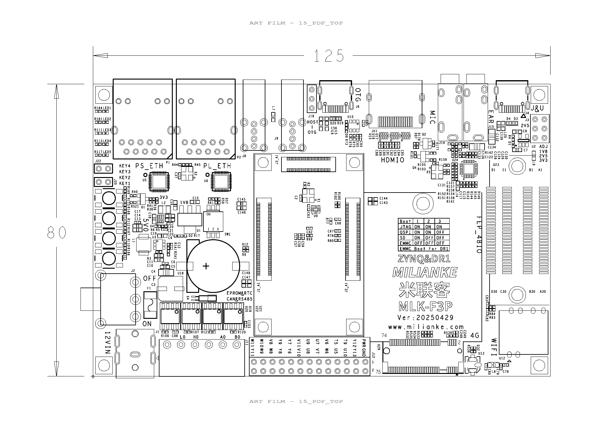

# 六轴舵机接线和调试

根据用户提供的 `D:/FPGA/referrence/02_hardware/hardware_MLK_F3P_CZ02_DR1_20250526/hardware_MLK_F3P_CZ02_DR1_20250526` 核对：开发板硬件手册第 23 页的 CEP 表，以及底板原理图第 16 页的 J12（2.54 mm、2×13）排针，与当前 `soc_prj/src/constraint/io.adc` 一致。

**板上找 J12 GPIO 排针，按 Y12/T9/T5/V6/U7/U9 的信号标注接线。** CEP 是手册中的接口名称，3/5/7/9/11/13 是排针序号；Y12 等同时是 DR1 球位名称。不能把信号标签 U7/U9 与板上芯片的器件位号混淆。

| Qt 轴号 / 参考舵机 ID | 部位 | J12 信号标签 | J12 针脚序号 | CLI 逻辑轴 | RTL 输出 |
| --- | --- | --- | ---: | ---: | --- |
| 1 | 夹爪 | Y12 | 3 | 0 | servo_pwm[0] |
| 2 | 腕部旋转 | T9 | 5 | 1 | servo_pwm[1] |
| 3 | 腕部俯仰 | T5 | 7 | 2 | servo_pwm[2] |
| 4 | 肘关节 | V6 | 9 | 3 | servo_pwm[3] |
| 5 | 肩关节 | U7 | 11 | 4 | servo_pwm[4] |
| 6 | 底座旋转 | U9 | 13 | 5 | servo_pwm[5] |

按附图方向（12VIN 在左下），J12 位于板下沿中间、12VIN 接口与 4G 插槽之间。从标有 PWR/GND 的那一端开始，跳过电源/地列，接下来六列各取上述信号标签：Y12、T9、T5、V6、U7、U9。每列另一针分别是 Y13、U10、U5、W6、V7、U8，本版未作为舵机输出。请按实际丝印定位，不在没有方向基准时凭左右数针。

这些引脚仅接舵机信号线，输出 3.3 V PWM。舵机使用与其额定电压匹配的独立电源，电源地与板地共地（J12 的 GND / 2 脚）。J12 的 PWR / 1 脚为 VCC_CEP1，不用它给六个舵机供电。PS 的 GPIO bank 2/3 发送控制字，PL 再从上述六针输出 PWM；并非每只舵机直接占用一个 PS GPIO。

## 调试次序

1. **启动与软件检查**：SD 装回开发板，从 SD 启动。串口为 CH342 通道 A、115200/8N1，COM 号动态发现。执行 `armctl --list` 核对 GPIO，运行 `/home/uisrc/qt_play/run_hdmi_ui.sh` 进入默认模拟模式；先检查界面和停止操作。
2. **PWM 信号检查**：确认使用配套的当前 `0xA6` 软件与 FPGA 构建；历史位流没有本轮状态回读和失联保持协议。每次连接先手动关闭 PWM（CLI `off` / `disable`），再确认六轴初始命令并启用。舵机电源和信号暂不连接到机械臂，用示波器或逻辑分析仪测板上输出，核对 50 Hz / 20 ms 周期、脉宽及引脚对应关系。
3. **逐轴校准**：明确舵机型号、电压、供电电流和初始姿态后，一次先连接一只舵机，以已知安全脉宽和小范围变化测试方向、限位与偏移；其余舵机信号/供电断开。支撑机械臂，避免失去保持力时下落。现有 PL 为全局启能，软件仍要求声明完整六轴初始脉宽，不能单独使某一输出启能。
4. **六轴和坐标检查**：逐轴实测完成后保存校准；测量四个连杆尺寸，再确认几何参数。先验证少量已知姿态和 FK/IK 结果，再播放短动作组。复位和大范围坐标运动在这些检查之后进行。

需要用户提供的现场信息：舵机型号/额定电压、独立电源规格、实际信号和共地接线、初始机械姿态、是否有测量仪器，以及 USB 串口连接状态。当前没有实机位置反馈；软件停止可保持命令，禁能会关闭 PWM，二者机械效果不同。

本轮离线修复没有部署程序、刷写位流或发送硬件启能、校准、运动命令；历史发布文件不代表当前源码已经上板验证。
